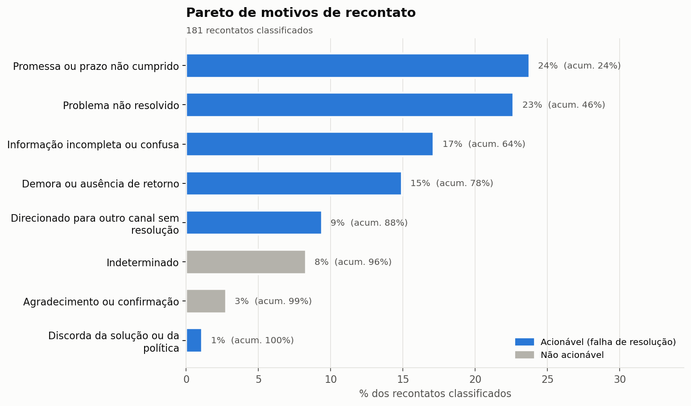
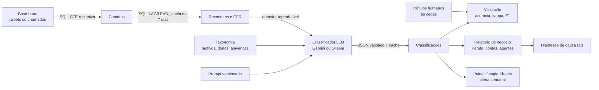

# Classificador de motivos de recontato com LLM

**Por que o cliente voltou?** Este projeto deriva o indicador de recontato a partir de conversas brutas de atendimento, usa um LLM para ler cada par de contatos e classificar o motivo do retorno, valida a classificação contra rótulos humanos e transforma o resultado em um plano de ação com área responsável.

`Python` · `SQL (DuckDB)` · `LLMs (Gemini e modelo local via Ollama)` · `Prompt engineering` · `Avaliação de modelos` · `Google Apps Script`

---

## O problema de negócio

Recontato é um dos indicadores mais caros de uma operação de atendimento. Cada retorno é demanda que não precisava existir: consome tempo de atendimento, pressiona SLA e dimensionamento, e quase sempre vem de um cliente mais insatisfeito do que na primeira vez.

O número sozinho, porém, não diz o que fazer. "O recontato subiu 3 p.p." não aponta para nenhuma alavanca. A tabulação manual de motivo costuma ser pobre (o agente escolhe "outros" ou o motivo do *primeiro* contato), e ler conversas uma a uma não escala.

A pergunta que este projeto responde é: **dos clientes que voltaram, por que voltaram, e quem na operação consegue corrigir cada causa?**

## O que o projeto entrega

- **Indicador derivado de dados brutos, em SQL:** reconstrução das conversas com CTE recursiva, recontato e FCR com funções de janela, tratamento de censura no fim da base.
- **Taxonomia operacional:** 9 motivos mutuamente exclusivos pela causa, cada um com área responsável e alavanca sugerida.
- **Classificador com LLM:** prompt versionado, saída em JSON com esquema fechado, evidência e resumo para auditoria, cache que retoma de onde parou.
- **Validação como auditoria de QA:** rotulagem humana às cegas, acurácia, kappa de Cohen, F1 por motivo e matriz de confusão.
- **Comparação de abordagens:** LLM na nuvem × modelo local × regras de palavras-chave, em acurácia, latência e custo.
- **Relatório de negócio gerado automaticamente:** Pareto de motivos, taxa de recontato *acionável*, FCR e mix de motivos por conta, produto e agente.
- **Hipóteses de causa raiz por LLM:** para os principais motivos, padrões, hipóteses (5 Porquês) e ações com dono e indicador.
- **Painel no Google Sheets com Apps Script:** Pareto e comparação semana contra semana, com alerta automático quando um motivo dispara.

## Resultados

<!--
  Preencha esta seção depois de rodar o pipeline na base real (passo a passo em "Como rodar").
  Os números saem do relatório em reports/twcs/ e da comparação em reports/twcs/comparacao_classificadores.md.
  Sugestão de estrutura:
  - Escala: X contatos analisados, taxa de recontato Y%, FCR Z%.
  - Achado principal: N% dos recontatos são falha de resolução; a taxa acionável é W% (vs Y% bruta).
  - Top 3 motivos e o que eles indicam para a operação.
  - Qualidade: acurácia e kappa do LLM vs regras, com o tamanho da amostra rotulada.
  - Custo: tokens por classificação e custo estimado por 1.000 casos.
  Depois, apague este comentário.
-->

Os relatórios completos de cada execução ficam em [`reports/`](reports/). Para ver o formato antes de rodar a base real, há relatórios de demonstração gerados com dados sintéticos:

- [Demonstração com a amostra no formato do Twitter](reports/twcs/relatorio_regras_palavras-chave-v1_v1.md) (classificador de regras)
- [Estudo de caso B2B de benefícios corporativos, empresa fictícia](reports/b2b/relatorio_regras_palavras-chave-v1_v1.md) (classificador de regras)



## Como funciona



## Dados

### Base principal: Customer Support on Twitter (Kaggle)

[Customer Support on Twitter](https://www.kaggle.com/datasets/thoughtvector/customer-support-on-twitter) é um corpus público de cerca de 2,8 milhões de tweets trocados entre clientes e contas de atendimento de grandes marcas, coletados em 2017.

Ela não traz um campo de recontato, e isso é proposital neste projeto: como cada tweet tem autor, marca, data e a indicação de qual tweet ele responde, dá para **reconstruir as conversas e derivar o recontato**, exatamente como seria feito a partir de logs de uma operação real.

### Estudo de caso B2B (sintético, em português)

Para mostrar o método em um contexto de **CX B2B**, o projeto inclui uma base sintética de chamados de uma empresa fictícia de benefícios corporativos ("Benefix"), atendendo RHs de empresas-cliente em produtos como cartão multibenefícios, despesas corporativas e premiações. Essa base tem campos que o Twitter não tem (produto, canal e agente), o que permite análises como FCR por agente para coaching.

Os dados são **inteiramente gerados por script** ([scripts/gerar_dados_amostra.py](scripts/gerar_dados_amostra.py)), não representam nenhuma empresa real e servem para demonstrar o formato da análise.

## Metodologia (resumo)

O detalhamento completo, com fórmulas e justificativas, está em [docs/metodologia.md](docs/metodologia.md).

1. **Do tweet ao contato.** Uma CTE recursiva sobe cada cadeia de respostas até o tweet raiz e agrupa a conversa. Entram só conversas iniciadas por cliente e respondidas pela marca; falas de terceiros são descartadas e IDs de clientes, anonimizados.
2. **Regra de recontato.** Um contato é recontato quando o mesmo cliente volta à mesma conta em até 7 dias após o **fim** do contato anterior. Contatos perto do fim da base, que ainda não tiveram tempo de gerar recontato, saem do cálculo do FCR (censura de janela).
3. **Taxonomia.** Nove motivos definidos pela *causa* do retorno, cada um com dono e alavanca:

   | Motivo | Área responsável típica |
   |---|---|
   | Problema não resolvido | Processos / Base de conhecimento |
   | Informação incompleta ou confusa | Treinamento / Qualidade |
   | Promessa ou prazo não cumprido | Processos / Backoffice |
   | Direcionado para outro canal sem resolução | Processos / Roteamento |
   | Demora ou ausência de retorno | Planejamento / WFM |
   | Discorda da solução ou da política | Produto / Política comercial |
   | Assunto novo · Agradecimento · Indeterminado | Não acionáveis |

4. **Classificação.** O LLM recebe o **par** de contatos (anterior e novo), porque "ainda nada" só vira "promessa não cumprida" quando se sabe que houve uma promessa. A saída é um JSON com motivo, confiança, evidência e resumo, restrito por esquema à lista de motivos.
5. **Validação.** Uma amostra é rotulada por uma pessoa sem ver a resposta do modelo. Além da acurácia, o kappa de Cohen desconta a concordância por acaso e o "acerto acionável" mede se o modelo separa bem falha de resolução de demanda legítima.
6. **Da classificação à ação.** O relatório separa a **taxa de recontato acionável** da bruta, mostra o Pareto com donos e cruza motivos por conta, produto e agente.

## Como rodar

Pré-requisitos: [Python 3.10+](https://www.python.org/downloads/) e [Git](https://git-scm.com/downloads). Os comandos abaixo funcionam no Windows (PowerShell); no Mac/Linux, troque `.venv\Scripts\activate` por `source .venv/bin/activate`.

### 1. Instalar

```bash
git clone git clone https://github.com/rhenanmendes/classificador-recontato-llm.git
cd classificador-recontato-llm
python -m venv .venv
.venv\Scripts\activate
pip install -r requirements.txt
```

### 2. Ver tudo funcionando (sem chave de API, sem baixar nada)

```bash
python main.py demo
```

Roda o pipeline inteiro nas duas amostras sintéticas, com o classificador de regras, e gera os relatórios em `reports/`.

### 3. Baixar a base real

Baixe a base no [Kaggle](https://www.kaggle.com/datasets/thoughtvector/customer-support-on-twitter) (precisa de conta gratuita), descompacte e coloque o arquivo `twcs.csv` em `data/raw/`.

```bash
python main.py preparar --fonte twcs
```

### 4. Configurar o LLM

**Opção A, Gemini (recomendada):** crie uma chave gratuita no [Google AI Studio](https://aistudio.google.com/apikey), copie `.env.example` para `.env` e cole a chave. O plano gratuito tem limite diário de requisições; o código respeita o limite, salva o progresso e continua de onde parou na próxima execução.

**Opção B, modelo local (sem custo e sem limite):** instale o [Ollama](https://ollama.com) e baixe um modelo pequeno. O padrão do projeto, `qwen3:4b`, cabe em placas de vídeo com 4 GB.

```bash
ollama pull qwen3:4b
```

### 5. Classificar, validar e gerar o relatório

```bash
# Classifica uma amostra de recontatos (tamanho em config.yaml, ou use --n)
python main.py classificar --fonte twcs --provedor gemini --n 500

# Exporta 150 casos para rotular à mão (abre no Excel)
python main.py rotular --fonte twcs --n 150
# -> preencha a coluna motivo_real e salve como data/rotulagem/twcs_rotulado.csv

# Relatório com avaliação e hipóteses de causa raiz
python main.py relatorio --fonte twcs --provedor gemini --gabarito data/rotulagem/twcs_rotulado.csv --hipoteses

# Compara LLM, modelo local e regras na mesma amostra rotulada
python main.py classificar --fonte twcs --provedor regras --n 500
python main.py classificar --fonte twcs --provedor ollama --n 500
python main.py comparar --fonte twcs --gabarito data/rotulagem/twcs_rotulado.csv
```

### 6. Rodar os testes

```bash
python -m pytest
```

### 7. Painel no Google Sheets (opcional)

O comando `relatorio` exporta `outputs/<fonte>/classificacoes_<execucao>.csv`. As instruções para transformar esse arquivo em um painel com alerta semanal estão no cabeçalho de [integracoes/google_sheets/Code.gs](integracoes/google_sheets/Code.gs).

## Estrutura do repositório

```
├── main.py                      # linha de comando: preparar, classificar, rotular, relatorio, comparar, demo
├── config.yaml                  # janela de recontato, provedor e modelo, tamanho da amostra
├── sql/
│   ├── twcs/                    # tweets -> conversas (CTE recursiva) -> contatos
│   ├── b2b/                     # chamados -> contatos
│   └── comum/                   # recontato, FCR e indicadores por dimensão (janelas, GROUPING SETS)
├── taxonomia/motivos_recontato.yaml
├── prompts/                     # prompts versionados (classificação e hipóteses de causa raiz)
├── src/recontato/
│   ├── preparacao.py            # executa o SQL no DuckDB
│   ├── provedores.py            # clientes Gemini e Ollama (mesma interface)
│   ├── regras.py                # baseline por palavras-chave
│   ├── classificador.py         # prompt, saída estruturada, cache e retomada
│   ├── avaliacao.py             # métricas contra o gabarito humano
│   ├── analise.py               # Pareto, contas, agentes, custo
│   ├── insights.py              # hipóteses de causa raiz por LLM
│   ├── graficos.py · relatorio.py
├── integracoes/google_sheets/   # painel e alerta em Apps Script
├── scripts/gerar_dados_amostra.py
├── data/amostra/                # amostras sintéticas + gabaritos
├── docs/metodologia.md
├── reports/                     # relatórios gerados (Markdown + gráficos)
└── tests/                       # testes do SQL, do classificador e dos clientes de API (sem internet)
```

## Decisões de projeto e limitações

- **Por que LLM e não um classificador treinado?** Não existe base rotulada de motivos de recontato, e rotular milhares de casos para treinar um modelo supervisionado é caro. O LLM funciona com poucas dezenas de exemplos rotulados (só para validar), entende os dois idiomas e permite mudar a taxonomia editando um arquivo.
- **Por que validar com rótulo humano?** Porque o LLM erra, principalmente entre motivos vizinhos. Sem uma medida de concordância, o Pareto seria só uma opinião bem formatada.
- **Por que comparar com regras?** Para mostrar o ganho real. Se palavras-chave resolvessem, não valeria o custo do LLM.
- **Proxy de caso:** o Twitter não tem número de protocolo, então "mesmo cliente + mesma marca em 7 dias" é uma aproximação. Com ID de caso, a regra fica mais precisa.
- **Canal público:** muitas marcas levam a conversa para mensagem privada, que não está na base.
- **Contexto:** a base real é em inglês, B2C e de 2017. O método se aplica a CX B2B em português, mas os números não são comparáveis.
- **Amostras sintéticas:** servem para testar o pipeline. As regras de palavras-chave foram escritas conhecendo os modelos de texto da amostra, então a acurácia delas ali não vale como evidência.

## Como isso se aplica a uma operação de CX B2B

1. **Rotina diária:** classificar os recontatos do dia anterior e atualizar o painel. O alerta semana contra semana vira gatilho para war room quando um motivo dispara.
2. **Plano de ação com dono:** cada motivo do Pareto já aponta a área (Processos, Treinamento, WFM, Produto) e a alavanca.
3. **Indicador mais honesto:** a taxa de recontato acionável separa falha de resolução de demanda legítima, e evita perseguir o número errado.
4. **Coaching direcionado:** o mix de motivos por agente mostra *o que* treinar, não só *quem* está abaixo da média.
5. **Próximos passos naturais:** conectar direto à base de tickets via SQL, agendar a execução diária, adicionar exemplos rotulados ao prompt (few-shot), resumos executivos de tickets complexos e monitoramento de deriva do modelo.

## Autor

**Rhenan Santos Mendes** · [LinkedIn](https://www.linkedin.com/in/rhenanmendes-109040137)

Projeto desenvolvido como portfólio em performance operacional e IA aplicada a CX.

Licença: [MIT](LICENSE).
