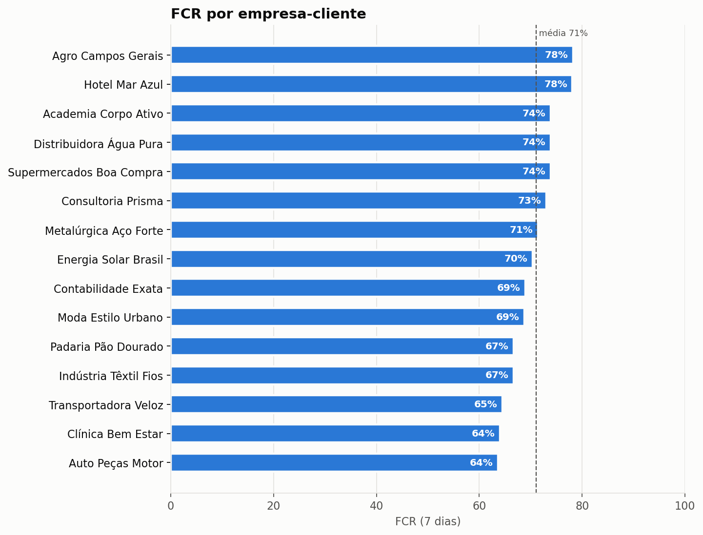
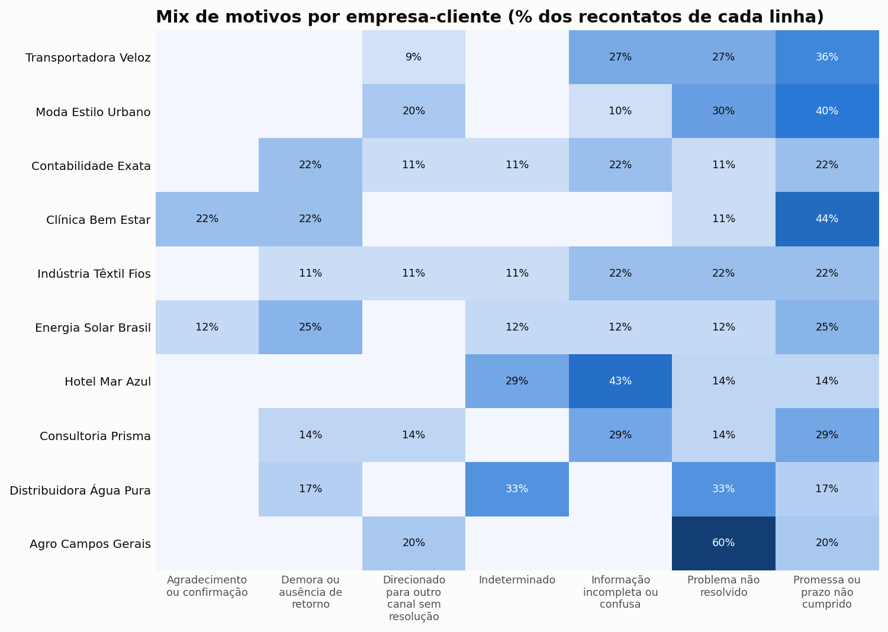
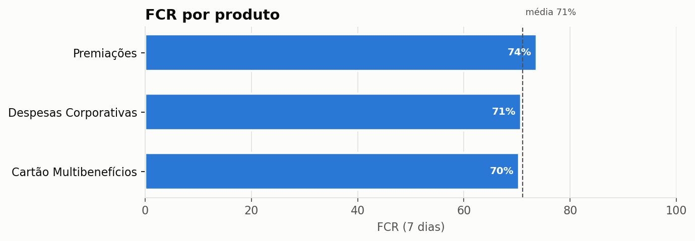
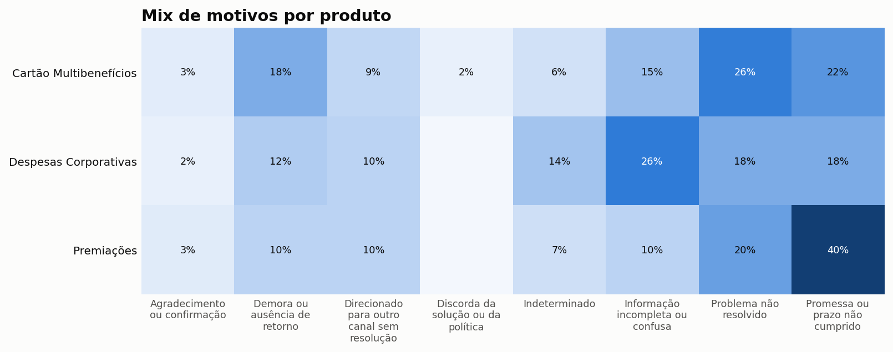
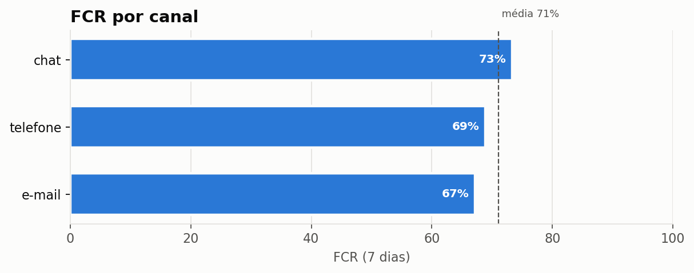
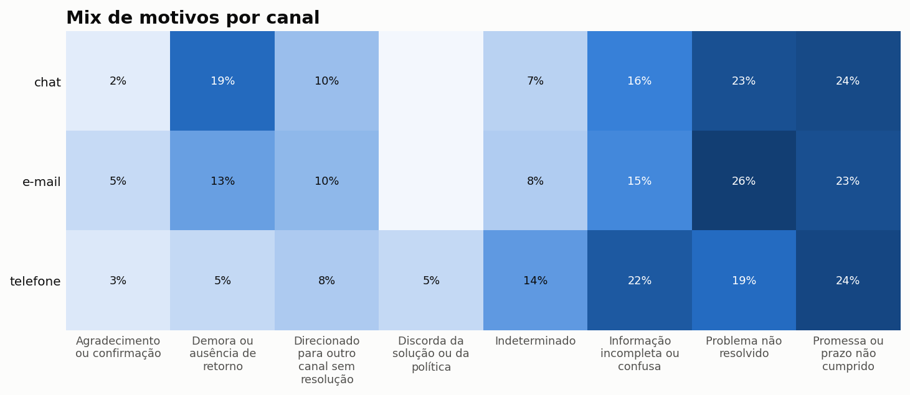
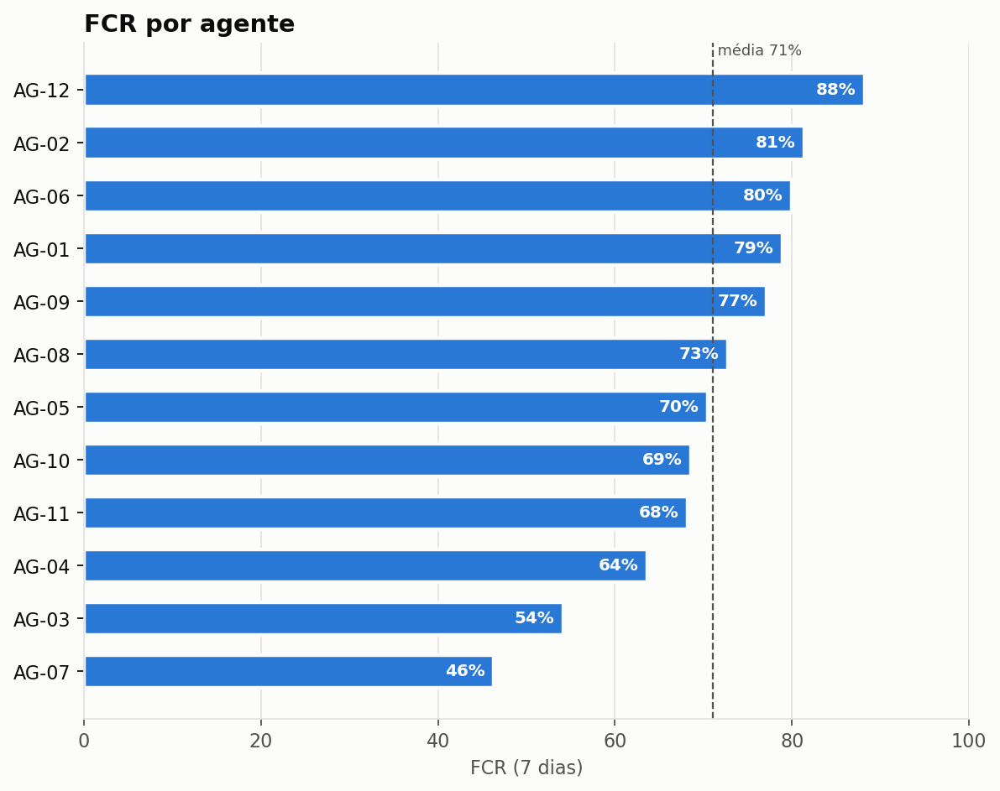
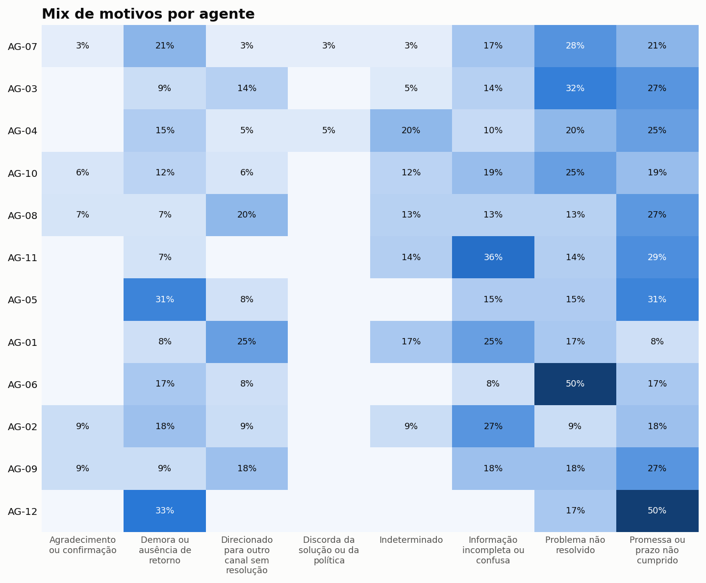
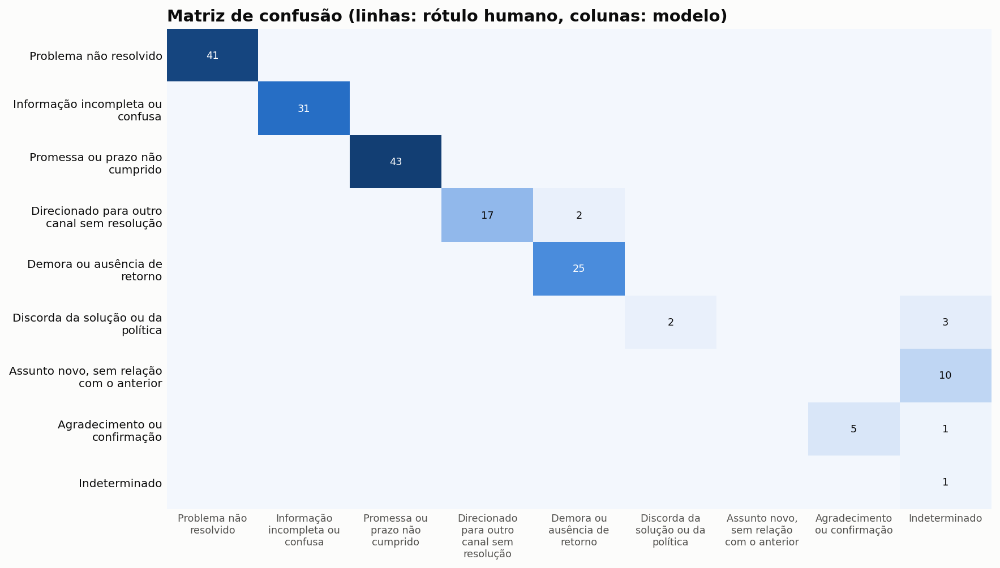

# Relatório de recontato: Chamados B2B de benefícios corporativos (empresa fictícia)

Gerado em 23/10/2026 11:37 · classificador `regras` (`palavras-chave-v1`, prompt `v1`) · janela de recontato de 7 dias · período 10/04/2026 a 30/08/2026

> **Atenção:** este relatório foi gerado a partir de dados SINTÉTICOS de amostra, criados para testar o pipeline. Os números ilustram o formato da análise e não representam nenhuma operação real.

## Resumo executivo

- **627 contatos** analisados, com **taxa de recontato de 28,9%** e **FCR de 71,1%** (resolução sem retorno em 7 dias). A mediana de tempo até o cliente voltar é de 82 horas.
- Dos 181 recontatos classificados, **89% indicam falha de resolução** (margem de erro de ±4,6 p.p.). Descontando assuntos novos, agradecimentos e casos indeterminados, a **taxa de recontato acionável é 25,7%**: 3,2 p.p. do indicador bruto não indicam falha de resolução identificável.
- **Os 3 principais motivos acionáveis concentram 64% dos recontatos:** Promessa ou prazo não cumprido (24%, dono: Processos / Áreas de backoffice); Problema não resolvido (23%, dono: Processos / Base de conhecimento); Informação incompleta ou confusa (17%, dono: Treinamento / Qualidade).
- Empresa-cliente com menor FCR: **Auto Peças Motor** (63,6%, contra 71,1% no total).
- **2 agente(s) com FCR mais de 10 p.p. abaixo da média** (AG-07, AG-03): candidatos a coaching direcionado pelo motivo predominante.

## Por que os clientes voltam

| Motivo | Qtd. | % | % acum. | Área responsável | Alavanca sugerida |
|---|---|---|---|---|---|
| Promessa ou prazo não cumprido | 43 | 24% | 24% | Processos / Áreas de backoffice | Auditar SLA das áreas que executam a promessa; alinhar o prazo comunicado ao prazo real. |
| Problema não resolvido | 41 | 23% | 46% | Processos / Base de conhecimento | Revisar o procedimento de solução e a árvore de diagnóstico; checar se o agente seguiu o fluxo. |
| Informação incompleta ou confusa | 31 | 17% | 64% | Treinamento / Qualidade | Ajustar scripts e macros para respostas completas; calibrar com os agentes o checklist de resposta. |
| Demora ou ausência de retorno | 27 | 15% | 78% | Planejamento / WFM | Checar dimensionamento e SLA de primeira resposta no período; revisar filas paradas. |
| Direcionado para outro canal sem resolução | 17 | 9% | 88% | Processos / Roteamento | Rever regras de transferência e roteamento; aumentar a resolução no próprio canal. |
| Indeterminado | 15 | 8% | 96% | - | Monitorar o volume; se crescer, revisar a qualidade dos dados de entrada. |
| Agradecimento ou confirmação | 5 | 3% | 99% | - | Excluir da taxa de recontato acionável; é sinal positivo. |
| Discorda da solução ou da política | 2 | 1% | 100% | Produto / Política comercial | Avaliar se a política gera atrito evitável; definir alçada de exceção para a ponta. |

## Indicadores por empresa-cliente

| Empresa-cliente | Contatos | Recontatos | Taxa de recontato | FCR | Mediana h até voltar |
|---|---|---|---|---|---|
| Moda Estilo Urbano | 32 | 10 | 31,2% | 68,8% | 104 |
| Hotel Mar Azul | 32 | 7 | 21,9% | 78,1% | 89 |
| Transportadora Veloz | 31 | 11 | 35,5% | 64,5% | 73 |
| Contabilidade Exata | 29 | 9 | 31,0% | 69,0% | 61 |
| Energia Solar Brasil | 27 | 8 | 29,6% | 70,4% | 38 |
| Indústria Têxtil Fios | 27 | 9 | 33,3% | 66,7% | 136 |
| Consultoria Prisma | 26 | 7 | 26,9% | 73,1% | 56 |
| Clínica Bem Estar | 25 | 9 | 36,0% | 64,0% | 64 |
| Agro Campos Gerais | 24 | 5 | 20,8% | 78,3% | 74 |
| Distribuidora Água Pura | 23 | 6 | 26,1% | 73,9% | 97 |
| Supermercados Boa Compra | 23 | 6 | 26,1% | 73,9% | 114 |
| Academia Corpo Ativo | 23 | 6 | 26,1% | 73,9% | 80 |
| Auto Peças Motor | 22 | 8 | 36,4% | 63,6% | 78 |
| Padaria Pão Dourado | 21 | 7 | 33,3% | 66,7% | 30 |
| Metalúrgica Aço Forte | 21 | 6 | 28,6% | 71,4% | 88 |

### Mix de motivos por empresa-cliente

Duas contas com a mesma taxa de recontato podem pedir ações diferentes: o mix de motivos mostra onde está a alavanca de cada uma.

## FCR por produto

## FCR por canal

## FCR por agente

> O agente considerado é o do contato que **gerou** o recontato (onde a resolução falhou). Use como insumo para calibração e coaching, nunca como ranking punitivo isolado: volume baixo e mix de casos distorcem a comparação.

## Exemplos por motivo

| Motivo | Empresa-cliente | Evidência no novo contato | Resumo do modelo |
|---|---|---|---|
| Agradecimento ou confirmação | Startup Pagaí | _funcionou_ | Classificado por regra de palavra-chave. |
| Agradecimento ou confirmação | Clínica Bem Estar | _funcionou_ | Classificado por regra de palavra-chave. |
| Agradecimento ou confirmação | Auto Peças Motor | _funcionou_ | Classificado por regra de palavra-chave. |
| Demora ou ausência de retorno | Metalúrgica Aço Forte | _ola?_ | Classificado por regra de palavra-chave. |
| Demora ou ausência de retorno | Clínica Bem Estar | _preciso de uma posicao_ | Classificado por regra de palavra-chave. |
| Demora ou ausência de retorno | Contabilidade Exata | _ola?_ | Classificado por regra de palavra-chave. |
| Direcionado para outro canal sem resolução | Editora Página Viva | _transferi_ | Classificado por regra de palavra-chave. |
| Direcionado para outro canal sem resolução | Restaurante Sabor Caseiro | _transferi_ | Classificado por regra de palavra-chave. |
| Direcionado para outro canal sem resolução | Moda Estilo Urbano | _e-?mail que voces passaram_ | Classificado por regra de palavra-chave. |
| Discorda da solução ou da política | Supermercados Boa Compra | _nao aceito_ | Classificado por regra de palavra-chave. |
| Discorda da solução ou da política | Construtora Horizonte | _nao aceito_ | Classificado por regra de palavra-chave. |
| Indeterminado | Seguradora Confiança | - | Classificado por regra de palavra-chave. |
| Indeterminado | Contabilidade Exata | - | Classificado por regra de palavra-chave. |
| Indeterminado | Editora Página Viva | - | Classificado por regra de palavra-chave. |
| Informação incompleta ou confusa | Grupo Saúde Integral | _qual (e/coluna)_ | Classificado por regra de palavra-chave. |
| Informação incompleta ou confusa | Indústria Têxtil Fios | _onde (fica/encontro)_ | Classificado por regra de palavra-chave. |
| Informação incompleta ou confusa | Escola Novo Saber | _onde (fica/encontro)_ | Classificado por regra de palavra-chave. |
| Problema não resolvido | Padaria Pão Dourado | _voltou a acontecer_ | Classificado por regra de palavra-chave. |
| Problema não resolvido | Energia Solar Brasil | _e o mesmo_ | Classificado por regra de palavra-chave. |
| Problema não resolvido | Indústria Têxtil Fios | _e o mesmo_ | Classificado por regra de palavra-chave. |
| Promessa ou prazo não cumprido | Energia Solar Brasil | _garantiram_ | Classificado por regra de palavra-chave. |
| Promessa ou prazo não cumprido | Transportadora Veloz | _garantiram_ | Classificado por regra de palavra-chave. |
| Promessa ou prazo não cumprido | Startup Pagaí | _disseram que_ | Classificado por regra de palavra-chave. |

## Qualidade do classificador

Comparação com 181 recontatos rotulados por uma pessoa, sem ver a resposta do modelo.

| Métrica | Valor |
|---|---|
| Acurácia | 91,2% |
| F1 macro | 0,72 |
| Kappa de Cohen | 0,89 |
| Acerto acionável x não acionável | 98,3% |

| Motivo | Precisão | Revocação | F1 | Casos |
|---|---|---|---|---|
| Promessa ou prazo não cumprido | 100% | 100% | 1,00 | 43 |
| Problema não resolvido | 100% | 100% | 1,00 | 41 |
| Informação incompleta ou confusa | 100% | 100% | 1,00 | 31 |
| Demora ou ausência de retorno | 93% | 100% | 0,96 | 25 |
| Direcionado para outro canal sem resolução | 100% | 89% | 0,94 | 19 |
| Assunto novo, sem relação com o anterior | 0% | 0% | 0,00 | 10 |
| Agradecimento ou confirmação | 100% | 83% | 0,91 | 6 |
| Discorda da solução ou da política | 100% | 40% | 0,57 | 5 |
| Indeterminado | 7% | 100% | 0,12 | 1 |

## Custo e desempenho do classificador

| Item | Valor |
|---|---|
| Classificações | 181 |
| Respostas fora do formato | 0,0% |
| Tokens de entrada (média) | 0 |
| Tokens de saída (média) | 0 |
| Latência média por chamada | 0,00 s |
| Custo estimado por 1.000 classificações | configure os preços em config.yaml |

---
Metodologia completa em [docs/metodologia.md](../../docs/metodologia.md).
