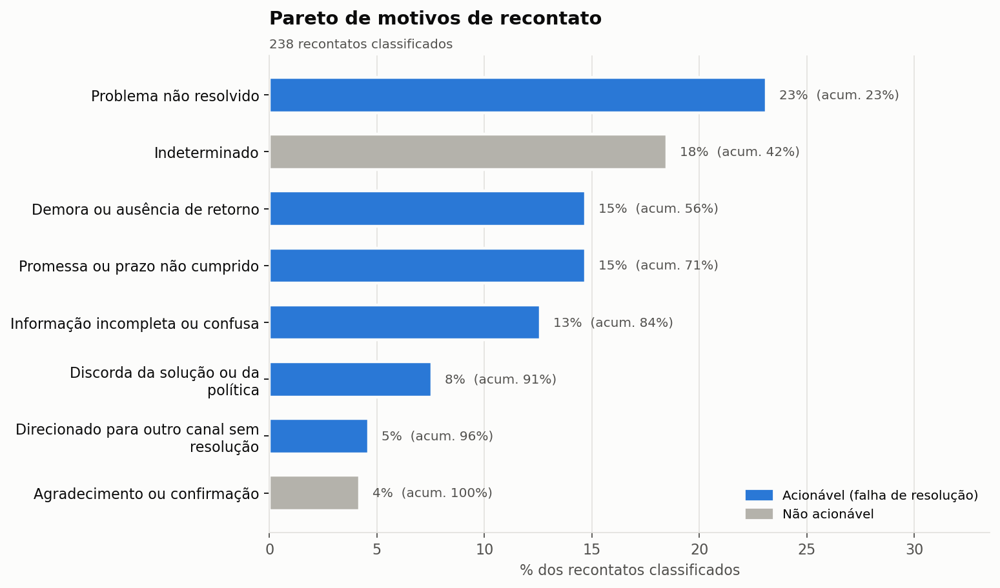
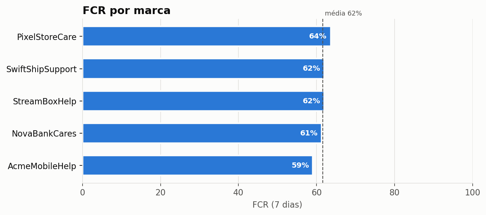
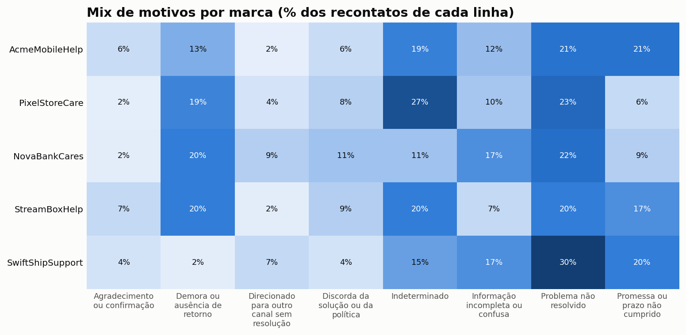
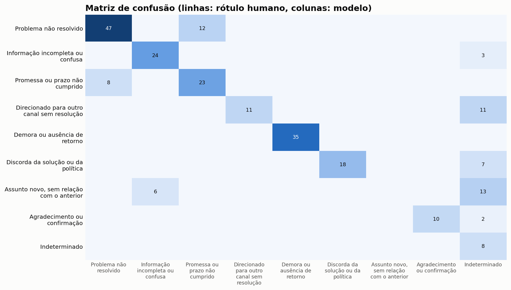

# Relatório de recontato: amostra sintética no formato Customer Support on Twitter

Gerado em 23/10/2026 11:37 · classificador `regras` (`palavras-chave-v1`, prompt `v1`) · janela de recontato de 7 dias · período 02/10/2017 a 04/12/2017

> **Atenção:** este relatório foi gerado a partir de dados SINTÉTICOS de amostra, criados para testar o pipeline. Os números ilustram o formato da análise e não representam nenhuma operação real.

## Resumo executivo

- **625 contatos** analisados, com **taxa de recontato de 38,1%** e **FCR de 61,6%** (resolução sem retorno em 7 dias). A mediana de tempo até o cliente voltar é de 68 horas.
- Dos 238 recontatos classificados, **77% indicam falha de resolução** (margem de erro de ±5,3 p.p.). Descontando assuntos novos, agradecimentos e casos indeterminados, a **taxa de recontato acionável é 29,4%**: 8,6 p.p. do indicador bruto não indicam falha de resolução identificável.
- **Os 3 principais motivos acionáveis concentram 53% dos recontatos:** Problema não resolvido (23%, dono: Processos / Base de conhecimento); Demora ou ausência de retorno (15%, dono: Planejamento / WFM); Promessa ou prazo não cumprido (15%, dono: Processos / Áreas de backoffice).
- Marca com menor FCR: **AcmeMobileHelp** (59,1%, contra 61,6% no total).

## Por que os clientes voltam

| Motivo | Qtd. | % | % acum. | Área responsável | Alavanca sugerida |
|---|---|---|---|---|---|
| Problema não resolvido | 55 | 23% | 23% | Processos / Base de conhecimento | Revisar o procedimento de solução e a árvore de diagnóstico; checar se o agente seguiu o fluxo. |
| Indeterminado | 44 | 18% | 42% | - | Monitorar o volume; se crescer, revisar a qualidade dos dados de entrada. |
| Demora ou ausência de retorno | 35 | 15% | 56% | Planejamento / WFM | Checar dimensionamento e SLA de primeira resposta no período; revisar filas paradas. |
| Promessa ou prazo não cumprido | 35 | 15% | 71% | Processos / Áreas de backoffice | Auditar SLA das áreas que executam a promessa; alinhar o prazo comunicado ao prazo real. |
| Informação incompleta ou confusa | 30 | 13% | 84% | Treinamento / Qualidade | Ajustar scripts e macros para respostas completas; calibrar com os agentes o checklist de resposta. |
| Discorda da solução ou da política | 18 | 8% | 91% | Produto / Política comercial | Avaliar se a política gera atrito evitável; definir alçada de exceção para a ponta. |
| Direcionado para outro canal sem resolução | 11 | 5% | 96% | Processos / Roteamento | Rever regras de transferência e roteamento; aumentar a resolução no próprio canal. |
| Agradecimento ou confirmação | 10 | 4% | 100% | - | Excluir da taxa de recontato acionável; é sinal positivo. |

## Indicadores por marca

| Marca | Contatos | Recontatos | Taxa de recontato | FCR | Mediana h até voltar |
|---|---|---|---|---|---|
| PixelStoreCare | 134 | 48 | 35,8% | 63,6% | 67 |
| AcmeMobileHelp | 128 | 52 | 40,6% | 59,1% | 75 |
| SwiftShipSupport | 122 | 46 | 37,7% | 62,0% | 72 |
| StreamBoxHelp | 122 | 46 | 37,7% | 62,0% | 57 |
| NovaBankCares | 119 | 46 | 38,7% | 61,3% | 70 |

### Mix de motivos por marca

Duas contas com a mesma taxa de recontato podem pedir ações diferentes: o mix de motivos mostra onde está a alavanca de cada uma.

## Exemplos por motivo

| Motivo | Marca | Evidência no novo contato | Resumo do modelo |
|---|---|---|---|
| Agradecimento ou confirmação | StreamBoxHelp | _problem solved_ | Classificado por regra de palavra-chave. |
| Agradecimento ou confirmação | SwiftShipSupport | _all good_ | Classificado por regra de palavra-chave. |
| Agradecimento ou confirmação | AcmeMobileHelp | _problem solved_ | Classificado por regra de palavra-chave. |
| Demora ou ausência de retorno | NovaBankCares | _hello?_ | Classificado por regra de palavra-chave. |
| Demora ou ausência de retorno | StreamBoxHelp | _hello?_ | Classificado por regra de palavra-chave. |
| Demora ou ausência de retorno | StreamBoxHelp | _any update_ | Classificado por regra de palavra-chave. |
| Direcionado para outro canal sem resolução | NovaBankCares | _the link_ | Classificado por regra de palavra-chave. |
| Direcionado para outro canal sem resolução | NovaBankCares | _called the number_ | Classificado por regra de palavra-chave. |
| Direcionado para outro canal sem resolução | SwiftShipSupport | _called the number_ | Classificado por regra de palavra-chave. |
| Discorda da solução ou da política | PixelStoreCare | _manager_ | Classificado por regra de palavra-chave. |
| Discorda da solução ou da política | StreamBoxHelp | _manager_ | Classificado por regra de palavra-chave. |
| Discorda da solução ou da política | NovaBankCares | _manager_ | Classificado por regra de palavra-chave. |
| Indeterminado | SwiftShipSupport | - | Classificado por regra de palavra-chave. |
| Indeterminado | StreamBoxHelp | - | Classificado por regra de palavra-chave. |
| Indeterminado | PixelStoreCare | - | Classificado por regra de palavra-chave. |
| Informação incompleta ou confusa | PixelStoreCare | _which (option/setting)_ | Classificado por regra de palavra-chave. |
| Informação incompleta ou confusa | AcmeMobileHelp | _how do i_ | Classificado por regra de palavra-chave. |
| Informação incompleta ou confusa | SwiftShipSupport | _which (option/setting)_ | Classificado por regra de palavra-chave. |
| Problema não resolvido | AcmeMobileHelp | _again_ | Classificado por regra de palavra-chave. |
| Problema não resolvido | AcmeMobileHelp | _again_ | Classificado por regra de palavra-chave. |
| Problema não resolvido | StreamBoxHelp | _again_ | Classificado por regra de palavra-chave. |
| Promessa ou prazo não cumprido | AcmeMobileHelp | _you said_ | Classificado por regra de palavra-chave. |
| Promessa ou prazo não cumprido | SwiftShipSupport | _you said_ | Classificado por regra de palavra-chave. |
| Promessa ou prazo não cumprido | StreamBoxHelp | _promised_ | Classificado por regra de palavra-chave. |

## Qualidade do classificador

Comparação com 238 recontatos rotulados por uma pessoa, sem ver a resposta do modelo.

| Métrica | Valor |
|---|---|
| Acurácia | 73,9% |
| F1 macro | 0,68 |
| Kappa de Cohen | 0,70 |
| Acerto acionável x não acionável | 88,7% |

| Motivo | Precisão | Revocação | F1 | Casos |
|---|---|---|---|---|
| Problema não resolvido | 85% | 80% | 0,82 | 59 |
| Demora ou ausência de retorno | 100% | 100% | 1,00 | 35 |
| Promessa ou prazo não cumprido | 66% | 74% | 0,70 | 31 |
| Informação incompleta ou confusa | 80% | 89% | 0,84 | 27 |
| Discorda da solução ou da política | 100% | 72% | 0,84 | 25 |
| Direcionado para outro canal sem resolução | 100% | 50% | 0,67 | 22 |
| Assunto novo, sem relação com o anterior | 0% | 0% | 0,00 | 19 |
| Agradecimento ou confirmação | 100% | 83% | 0,91 | 12 |
| Indeterminado | 18% | 100% | 0,31 | 8 |

## Custo e desempenho do classificador

| Item | Valor |
|---|---|
| Classificações | 238 |
| Respostas fora do formato | 0,0% |
| Tokens de entrada (média) | 0 |
| Tokens de saída (média) | 0 |
| Latência média por chamada | 0,00 s |
| Custo estimado por 1.000 classificações | configure os preços em config.yaml |

---
Metodologia completa em [docs/metodologia.md](../../docs/metodologia.md).
